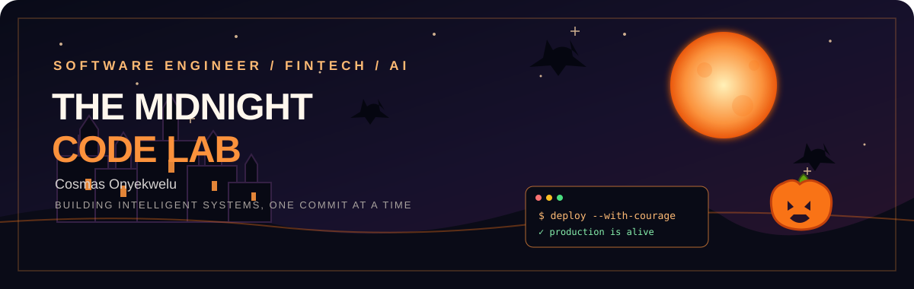

# Cosmas Onyekwelu

### Software Engineer | Fintech & AI | Backend-Leaning Full-Stack Developer

I build secure APIs, practical fintech products, AI-powered workflows, and web applications that solve real-world problems.

[Portfolio](https://cosmasonyekwelu.com/) · [LinkedIn](https://linkedin.com/in/cosmasonyekwelu) · [Substack](https://cosmasonyekwelu.substack.com/) · [X](https://x.com/cosmasonyekwelu)

---

## About Me

I'm a Lagos-based software engineer focused on backend development, full-stack product engineering, fintech, and AI integrations.

I work across the product lifecycle: designing APIs, building application backends, integrating databases and third-party services, and delivering user-facing experiences. I'm particularly interested in the intersection of financial infrastructure, cryptocurrency, intelligent automation, and useful AI products.

- Building with **Node.js, Python, Django, React, and TypeScript**.
- Interested in **fintech infrastructure, payments, crypto products, AI agents, and workflow automation**.
- Experienced in developing authentication systems, dashboards, marketplace workflows, and API integrations.
- Open to **remote and hybrid software engineering opportunities**.

## Tech Stack

### Languages

### Frontend

### Backend & APIs

### Databases

### Tools & Platforms

## Featured Projects

### [BambiFound](https://github.com/cosmasonyekwelu/BambiFound)
A product-focused build centered on practical user value and streamlined workflows.

### [OTCbook](https://github.com/cosmasonyekwelu/capstone-version-otcbook)
A trading and OTC-related workflow project built around operational efficiency and automation.

### [worknest](https://github.com/cosmasonyekwelu/worknest-backend)
A workspace-focused platform aimed at improving collaboration, operations, and team productivity.

### [intelihr](https://github.com/cosmasonyekwelu/intelihr)
An HR and workforce systems project focused on smarter internal processes and digital operations.

> Explore my repositories for more experiments, product builds, and engineering work.

## What I'm Exploring

- AI agents and reliable agentic workflows
- LLM integrations, retrieval-augmented generation, and tool calling
- Fintech APIs, stablecoins, crypto payments, and OTC trading systems
- Secure backend architecture, API design, and automation
- Building products from practical user and business problems

## GitHub Activity

## Let's Connect

I'm open to conversations about software engineering roles, fintech products, AI integrations, backend systems, and interesting collaborations.

- **Email:** [onyecosmas@gmail.com](mailto:onyecosmas@gmail.com)
- **Website:** [cosmasonyekwelu.com](https://cosmasonyekwelu.com/)
- **LinkedIn:** [linkedin.com/in/cosmasonyekwelu](https://linkedin.com/in/cosmasonyekwelu)
- **X:** [@cosmasonyekwelu](https://x.com/cosmasonyekwelu)
- **Writing:** [cosmasonyekwelu.substack.com](https://cosmasonyekwelu.substack.com/)

---

### THE MIDNIGHT CODE LAB

*Turning complex problems into practical systems — one commit at a time.*

Have a great Halloween. Keep building. Keep shipping.

